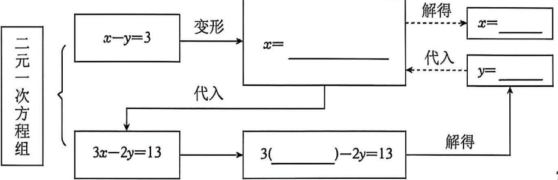

（5分）（1）完成下面框图中解方程组的过程：

（2）上面框图所示的解方程组的方法是 ___ .

> [!question]- 点击查看答案与解析
> **【答案】** （2）代入消元法
> 
> **【考点】** 解二元一次方程组的方法 → [[【初中数学知识点体系-人教版】#10-2 消元——解二元一次方程组]]
> 
> **【解析】**
> （1）框图中解方程组的过程：
> 从图中可以看出，首先将其中一个方程变形，用一个未知数表示另一个未知数，然后代入另一个方程，消去一个未知数，解出一个未知数，再回代求出另一个未知数。
> （2）上面框图所示的解方程组的方法是代入消元法。
> 
> **【易错点】** 容易混淆代入消元法和加减消元法。
