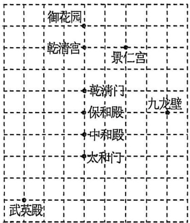

（5分） 如图是利用平面直角坐标系画出的故宫博物院主要建筑分布图（图中的小方格均为边长为 1 的正方形），其中太和门的坐标为 $(0,-1)$，九龙壁的坐标为 $(4,1)$.

（1）在图中画出平面直角坐标系，并写出景仁宫的坐标；

（2）如果养心般的坐标是 $(-2,3)$，在图中用点 P 表示它的位置.

> [!question]- 点击查看答案与解析
> **【答案】** （1）景仁宫的坐标为$(2,3)$；（2）点$P$的位置需根据养心殿的坐标$(-2,3)$确定
> 
> **【考点】** 平面直角坐标系的建立与应用 → [[【初中数学知识点体系-人教版】#9-1 用坐标描述平面内点的位置]]
> 
> **【解析】**
> （1）根据太和门的坐标为$(0,-1)$，九龙壁的坐标为$(4,1)$，可以确定坐标系的原点和方向。
> 从图中可以看出，太和门在九龙壁的左下方，且水平距离为4个单位，竖直距离为2个单位。
> 由此可以确定坐标系，并读出景仁宫的坐标为$(2,3)$。
> （2）养心殿的坐标是$(-2,3)$，在图中找到横坐标为$-2$，纵坐标为$3$的点，用点$P$表示即可。
> 
> **【易错点】** 建立坐标系时容易确定错原点位置或坐标轴方向。
