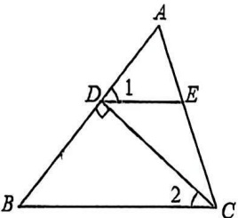

（6分）按要求完成下列证明：

已知：如图，在 $\triangle ABC$ 中，$CD \perp AB$ 于点 $D$，$E$ 是 $AC$ 上一点，且 $\angle1 + \angle2 = 90^\circ$。

求证：$DE \parallel BC$ 

证明：$\because CD \perp AB$（已知），

$\therefore \angle1 + \underline{\qquad} = 90^{\circ}(\underline{\qquad})$.

$\because \angle1 + \angle2 = 90^\circ$（已知），

$\therefore$ ___ = $\angle2$ ( ___ ).

 $\therefore DE // BC$ ( ___ ).

> [!question]- 点击查看答案与解析
> **【答案】** 见解析
> 
> **【考点】** 平行线的判定 → [[【初中数学知识点体系-人教版】#7-2 平行线]]
> 
> **【解析】**
> 证明：$\because CD\perp AB$（已知），
> $\therefore\angle1+\angle ACD=90^{\circ}$（直角三角形的两锐角互余）。
> $\because\angle1+\angle2=90^{\circ}$（已知），
> $\therefore\angle ACD=\angle2$（同角的余角相等）。
> $\therefore DE//BC$（内错角相等，两直线平行）。
> 
> **【易错点】** 容易忽略"同角的余角相等"这一性质；容易混淆平行线的判定定理。
