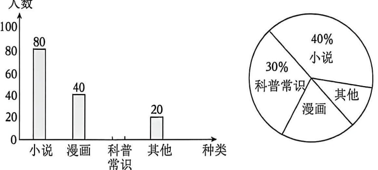

（6分）为了更好的开展"我爱阅读"活动，小明针对某校七年级部分学生（该校七年级共有 16 个班，480 名学生）课外阅读喜欢图书的种类（每人只能选一种书籍）进行了调查．并且他根据问卷调查的结果绘制了如下两幅不完整的统计图，根据图中提供的信息解答下列问题：

（1）在扇形统计图中，"其它"所在的扇形的圆心角等于 ___ 度；

（2）补全条形统计图：

（3）根据调查结果，估计七年级课外阅读喜欢"漫画"的同学有 ___ 人.

> [!question]- 点击查看答案与解析
> **【答案】** （1）72度；（2）补全条形统计图；（3）120人
> 
> **【考点】** 统计图的阅读与分析 → [[【初中数学知识点体系-人教版】#12-2 用统计图描述数据]]
> 
> **【解析】**
> （1）从扇形统计图中可以看出，"其它"占的比例为$\frac{72}{360}=20\%$，所以"其它"所在的扇形的圆心角等于72度。
> （2）根据统计图中的数据，补全条形统计图。
> （3）根据调查结果，喜欢"漫画"的同学占的比例乘以总人数480，即可估计七年级课外阅读喜欢"漫画"的同学人数。
> 从图中可以看出喜欢"漫画"的比例为25%，所以人数为$480\times25\%=120$人。
> 
> **【易错点】** 读取统计图数据时容易看错；计算时容易出错。
