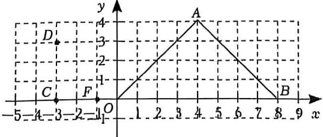

（6分）如图，在平面直角坐标系 xOy 中，$A(4,4)$，$B(8,0)$，$C(-3,0)$，$D(-3,3)$，$F(-1,0)$.

（1）如果四边形 DCFE 是长方形，请画出该长方形，并直接写出点 E 的坐标；

（2）将长方形 DCFE 向右平移 $t$ 个单位长度，得到长方形 $D^{\prime}C^{\prime}F^{\prime}E^{\prime}$ 

$①$ 当点 $E'$ 落在线段 AB 上时，结合图形直接写出此时 $t$ 的值；

$②$ 横、纵坐标都是整数的点叫做整点．如果长方形 $D'C'F'E'$ 和三角形 AOB 重叠区域（不含边界）内恰好有 3 个整点，直接写出 $t$ 的取值范围.

> [!question]- 点击查看答案与解析
> **【答案】** （1）点$E$的坐标为$(-1,3)$；（2）$①t=6$；$②$见解析
> 
> **【考点】** 平面直角坐标系、图形平移、整点 → [[【初中数学知识点体系-人教版】#9-2 坐标方法的简单应用]]
> 
> **【解析】**
> （1）长方形$DCFE$中，$D(-3,3)$，$C(-3,0)$，$F(-1,0)$。
> 因为$DCFE$是长方形，所以$E$的横坐标与$F$相同，纵坐标与$D$相同。
> 所以点$E$的坐标为$(-1,3)$。
> （2）$①$长方形$DCFE$向右平移$t$个单位长度后，$E'$的坐标为$(-1+t,3)$。
> 当点$E'$落在线段$AB$上时，需要满足线段$AB$的方程。
> $A(4,4)$，$B(8,0)$，线段$AB$的斜率为$\frac{0-4}{8-4}=-1$。
> 线段$AB$的方程为$y-4=-1(x-4)$，即$y=-x+8$。
> 将$E'(-1+t,3)$代入：$3=-(-1+t)+8$，$3=9-t$，解得$t=6$。
> $②$需要分析长方形$D'C'F'E'$和三角形$AOB$重叠区域内的整点个数，根据$t$的不同取值范围讨论。
> 
> **【易错点】** 求直线方程时容易计算错误；分析整点时容易遗漏或重复计算。
