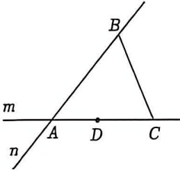
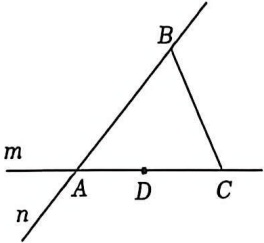

（7分）如图，直线 $m$ 和 $n$ 相交于点 $A$，点 $D$，$C$ 是直线 $m$ 上两点，点 $B$ 是直线 $n$ 上一点，连接 $BC$，并过点 $D$ 作 $DE//BC$ 交直线 $n$ 于点 $E$，点 $F$ 是直线 $n$ 上一动点，连接 $FD$ 和 $FC$，设 $\angle EDF = \alpha$，$\angle FCB = \beta$，$\angle DFC = \gamma$。

（1）当点 F 在线段 BE 上时，

$①$ 依题意补全图：

$②$ 判断 $a,\ \beta,\ \gamma$ 的数量关系并加以证明.

（2）当点 F 不在线段 BE 上时，直接写出 $\alpha$，$\beta$，$\gamma$ 的数量关系，不用证明.

备用图 

> [!question]- 点击查看答案与解析
> **【答案】** （1）$②\alpha+\beta+\gamma=180^{\circ}$；（2）见解析
> 
> **【考点】** 平行线的性质、三角形内角和 → [[【初中数学知识点体系-人教版】#7-2 平行线]]
> 
> **【解析】**
> （1）$①$依题意补全图形。
> $②$因为$DE//BC$，所以$\angle EDF+\angle FCB=\angle DFC$（需要结合图形分析）。
> 在$\triangle DFC$中，$\angle DFC+\angle FDC+\angle FCD=180^{\circ}$。
> 因为$DE//BC$，所以$\angle EDF=\angle DFC$（内错角相等）。
> 所以$\alpha+\beta+\gamma=180^{\circ}$。
> （2）当点$F$不在线段$BE$上时，需要根据点$F$的位置分类讨论，直接写出$\alpha$，$\beta$，$\gamma$的数量关系。
> 
> **【易错点】** 容易忽略分类讨论；利用平行线性质时容易混淆角的对应关系。
