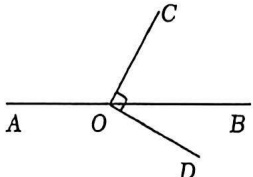

如图，点 O 在直线 AB 上，$OC \perp OD$，若 $\angle BOD = 40^{\circ}$，则 $\angle AOC$ 的度数是 ( )

A. $120^{\circ}$

B. $130^{\circ}$

C. $140^{\circ}$

D. $150^{\circ}$

> [!question]- 点击查看答案与解析
> **【答案】** C
> 
> **【考点】** 垂线的性质、平角的定义、角的计算 → [[【初中数学知识点体系-人教版】#7-1 相交线]]
> 
> **【解析】**
> 因为 $OC \perp OD$，所以 $\angle COD=90^{\circ}$。
> 因为点 O 在直线 AB 上，所以 $\angle AOB=180^{\circ}$（平角）。
> 根据图形，$\angle AOC$ 与 $\angle BOD$ 在直线 AB 的两侧，
> $\angle AOC=180^{\circ}-\angle BOD=180^{\circ}-40^{\circ}=140^{\circ}$。
> A 选项 $120^{\circ}$ 计算错误；
> B 选项 $130^{\circ}$ 是 $\angle COB$ 的度数，不是 $\angle AOC$；
> C 选项 $140^{\circ}$ 正确；
> D 选项 $150^{\circ}$ 计算错误。
> 
> **【易错点】** 对图形中角的位置关系理解不清，混淆不同角的度数
