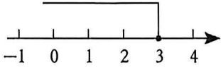
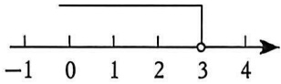
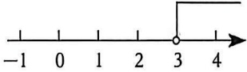
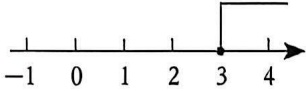

在数轴上表示不等式 $2x - 6 < 0$ 的解集，正确的是 ( )

A.

B.

C.

D.

> [!question]- 点击查看答案与解析
> **【答案】** C
> 
> **【考点】** 一元一次不等式的解法、在数轴上表示不等式的解集 → [[【初中数学知识点体系-人教版】#11-2 一元一次不等式]]
> 
> **【解析】**
> 解不等式 $2x - 6 < 0$：
> 移项得 $2x < 6$，
> 系数化为 1 得 $x < 3$。
> 在数轴上表示 $x < 3$：在 3 的左边画空心圆圈（因为不含等号），向左画箭头。
> A 选项：数轴表示的是 $x > 3$，错误；
> B 选项：数轴表示的是 $x \geqslant 3$，错误；
> C 选项：数轴表示的是 $x < 3$，正确；
> D 选项：数轴表示的是 $x \leqslant 3$，错误。
> 
> **【易错点】** 在数轴上表示不等式解集时，空心圆圈与实心圆点的区别，以及方向的选择
