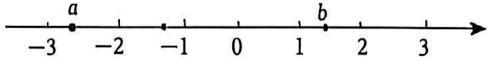

a, b 在数轴上的对应点的位置如图所示，则正确的结论是( )

A. $a > -2$

B. $|a| < |b|$

C. $ab > 0$

D. $a < -b$

> [!question]- 点击查看答案与解析
> **【答案】** D
> 
> **【考点】** 数轴上的数的大小比较、绝对值、相反数 → [[【初中数学知识点体系-人教版】#1-2 有理数及其大小比较]]
> 
> **【解析】**
> 从数轴可以看出：$a < -2 < 0 < b < 2$，且 $|a| > 2$，$|b| < 2$。
> A 选项：$a > -2$，从数轴看 $a < -2$，错误；
> B 选项：$|a| < |b|$，因为 $|a| > 2$，$|b| < 2$，所以 $|a| > |b|$，错误；
> C 选项：$ab > 0$，因为 $a < 0$，$b > 0$，所以 $ab < 0$，错误；
> D 选项：$a < -b$，因为 $a < -2$，$0 < b < 2$，所以 $-2 < -b < 0$，又 $a < -2$，所以 $a < -b$，正确。
> 
> **【易错点】** 数轴上数的位置关系判断，绝对值大小的比较，相反数的位置
