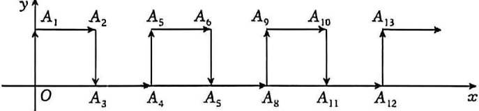

如图，在平面直角坐标系中，一动点从原点 O 出发，按向上，向右，向下，向右的方向不断地移动，每移动一个单位，得到点 $A_{1}(0,1)$，$A_{2}(1,1)$，$A_{3}(1,0)$，$A_{4}(2,0)$，那么 $A_{2023}$ 坐标为（）

A. (2023,1)

B. (2023,0)

C. (1011,1)

D. (1011,0)

> [!question]- 点击查看答案与解析
> **【答案】** D
> 
> **【考点】** 平面直角坐标系中点的坐标规律、周期性 → [[【初中数学知识点体系-人教版】#9-1 用坐标描述平面内点的位置]]
> 
> **【解析】**
> 分析点的移动规律：
> $A_1(0,1)$：向上 1 个单位；
> $A_2(1,1)$：向右 1 个单位；
> $A_3(1,0)$：向下 1 个单位；
> $A_4(2,0)$：向右 1 个单位；
> $A_5(2,1)$：向上 1 个单位；
> $A_6(3,1)$：向右 1 个单位；
> $A_7(3,0)$：向下 1 个单位；
> $A_8(4,0)$：向右 1 个单位；
> ...
> 规律：每 4 个点为一个周期，横坐标增加 2，纵坐标按 1,1,0,0 循环。
> $2023 \div 4=505 \cdots 3$，所以 $A_{2023}$ 是第 506 个周期的第 3 个点。
> 第 506 个周期结束时（即 $A_{2020}$）的横坐标为 $505 \times 2=1010$。
> $A_{2021}$：$(1010, 1)$；
> $A_{2022}$：$(1011, 1)$；
> $A_{2023}$：$(1011, 0)$。
> A 选项 $(2023, 1)$ 错误；
> B 选项 $(2023, 0)$ 错误；
> C 选项 $(1011, 1)$ 是 $A_{2022}$ 的坐标，错误；
> D 选项 $(1011, 0)$ 正确。
> 
> **【易错点】** 周期性规律的发现和应用，余数的计算，坐标的递推
