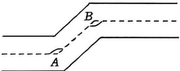

如图，一条公路两次转弯后，和原来的方向相同．如果第一次的拐角 $\angle A$ 是 $135^{\circ}$，则第二次的拐角 $\angle B$ 是 ___ ，根据是 ___ .

> [!question]- 点击查看答案与解析
> **【答案】** $135^{\circ}$；两直线平行，内错角相等
> 
> **【考点】** 平行线的性质、内错角 → [[【初中数学知识点体系-人教版】#7-2 平行线]]
> 
> **【解析】**
> 因为公路两次转弯后方向相同，所以转弯前后的两条公路平行。
> 第一次拐角 $\angle A=135^{\circ}$，第二次拐角 $\angle B$ 与 $\angle A$ 是内错角。
> 根据"两直线平行，内错角相等"，$\angle B=\angle A=135^{\circ}$。
> 
> **【易错点】** 平行线性质的应用，内错角、同位角、同旁内角的识别
