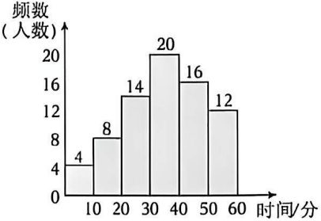

小华同学统计了他所在小区居民每天手机阅读的时间，并绘制了直方图，如图所示：

$①$ 小华同学一共统计了 74 人；
$②$ 每天手机阅读不足 20 分钟的人数有 8 人；
$③$ 每天手机阅读 30~40 分钟的人数最多；
$④$ 每天手机阅读 0~10 分钟的人数最少。

根据图中信息，上述说法中正确的是 ___ 。

> [!question]- 点击查看答案与解析
> **【答案】** $①$ $③$
> 
> **【考点】** 频数分布直方图的识读、数据分析 → [[【初中数学知识点体系-人教版】#12-2 用统计图描述数据]]
> 
> **【解析】**
> 从直方图读取各时间段的人数：
> $0 \sim 10$ 分钟：5 人；
> $10 \sim 20$ 分钟：10 人；
> $20 \sim 30$ 分钟：25 人；
> $30 \sim 40$ 分钟：30 人；
> $40 \sim 50$ 分钟：4 人。
> $①$ 总人数：$5 + 10 + 25 + 30 + 4=74$ 人，正确；
> $②$ 每天手机阅读不足 20 分钟的人数：$5 + 10=15$ 人，不是 8 人，错误；
> $③$ 每天手机阅读 $30 \sim 40$ 分钟的人数最多（30 人），正确；
> $④$ 每天手机阅读 $0 \sim 10$ 分钟的人数（5 人）不是最少，$40 \sim 50$ 分钟（4 人）更少，错误。
> 所以正确的是 $①$ $③$。
> 
> **【易错点】** 直方图数据的准确读取，"不足"和"以上"的范围理解
