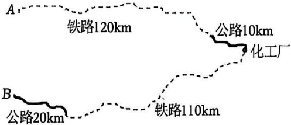

某化工厂与 A，B 两地有公路、铁路相连。这家工厂从 A 地购买一批每吨 1000 元的原料运回工厂，制成每吨 8000 元的产品运到 B 地，已知公路运价为 1.5 元/ $t \cdot km$，铁路运价为 1.2 元/ $t \cdot km$，且这两次运输共支出公路运费 15000 元，铁路运费 97200 元。设购买 $xt$ 原料，制成 $yt$ 产品。则从 A 地到这家化工厂原料运输费是 ___ ，这批产品的销售款比原料费与运输费的和多 ___ 元。

> [!question]- 点击查看答案与解析
> **【答案】** $50460$ 元；$2957800$ 元
> 
> **【考点】** 二元一次方程组的应用、利润计算 → [[【初中数学知识点体系-人教版】#10-3 实际问题与二元一次方程组]]
> 
> **【解析】**
> 设购买 $x$ t 原料，制成 $y$ t 产品。
> 根据题意列方程组：
> 公路运费：$1.5 \times 20x + 1.5 \times 10y=15000$，
> 即 $30x + 15y=15000$，化简得 $2x + y=1000 \quad \cdots \text{①}$
> 铁路运费：$1.2 \times 120x + 1.2 \times 110y=97200$，
> 即 $144x + 132y=97200$，化简得 $12x + 11y=8100 \quad \cdots \text{②}$
> $\text{①} \times 11$：$22x + 11y=11000 \quad \cdots \text{③}$
> $\text{③} - \text{②}$：$10x=2900$，$x=290$。
> 代入 $\text{①}$：$580 + y=1000$，$y=420$。
> 从 A 地到工厂的运输费：$1.5 \times 20 \times 290 + 1.2 \times 120 \times 290=8700 + 41760=50460$ 元。
> 销售款 $=8000 \times 420=3360000$ 元；
> 原料费 $=1000 \times 290=290000$ 元；
> 运输费总和 $=15000 + 97200=112200$ 元；
> 销售款比原料费与运输费的和多：$3360000 - 290000 - 112200=2957800$ 元。
> 
> **【易错点】** 两次运输的区分，公路和铁路运费的分项计算，利润的正确计算
