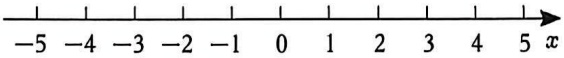

解不等式组：$\begin{cases}2x+3\geqslant x+1\\\dfrac{2x+5}{3}-1<2-x\end{cases}$，并把它的解集在数轴上表示出来.

> [!question]- 点击查看答案与解析
> **【答案】** $-2 \leqslant x < \dfrac{4}{5}$
> 
> **【考点】** 一元一次不等式组的解法、在数轴上表示解集 → [[【初中数学知识点体系-人教版】#11-3 一元一次不等式组]]
> 
> **【解析】**
> 解不等式 $①$：$2x + 3 \geqslant x + 1$
> $2x - x \geqslant 1 - 3$
> $x \geqslant -2$
> 解不等式 $②$：$\dfrac{2x + 5}{3} - 1 < 2 - x$
> $\dfrac{2x + 5 - 3}{3} < 2 - x$
> $\dfrac{2x + 2}{3} < 2 - x$
> 两边同乘 3：$2x + 2 < 6 - 3x$
> $2x + 3x < 6 - 2$
> $5x < 4$
> $x < \dfrac{4}{5}$
> 所以不等式组的解集是 $-2 \leqslant x < \dfrac{4}{5}$。
> 在数轴上表示：在 $-2$ 处画实心圆点，在 $\dfrac{4}{5}$ 处画空心圆圈，两点之间画线。
> 
> **【易错点】** 不等式 $②$ 的去分母，不等号方向的处理，数轴上实心与空心圆点的区别
