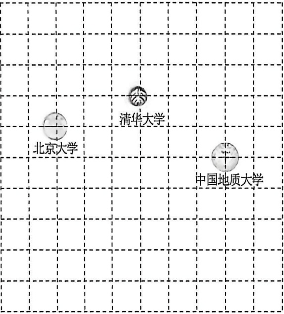

如图是北京市三所大学位置的平面示意图，图中小方格都是边长为 1 个单位长度的正方形，若清华大学的坐标为 $(0,3)$，北京大学的坐标为 $(-3,2)$ .

（1）请在图中画出平面直角坐标系，并写出中国地质大学的坐标： ___ ；

（2）若中国人民大学的坐标为 $(-3,-4)$，请在坐标系中标出中国人民大学的位置.

> [!question]- 点击查看答案与解析
> **【答案】** （1）中国地质大学的坐标为 $(2, 1)$；（2）中国人民大学的位置在 $(-3, -4)$
> 
> **【考点】** 平面直角坐标系的建立、点的坐标确定 → [[【初中数学知识点体系-人教版】#9-1 用坐标描述平面内点的位置]]
> 
> **【解析】**
> （1）根据清华大学 $(0, 3)$ 和北京大学 $(-3, 2)$ 的坐标，可以确定坐标系：
> 清华大学在 $y$ 轴上（横坐标为 0），北京大学在第二象限。
> 以小方格边长为单位长度，建立平面直角坐标系，原点在清华大学正下方 3 个单位处。
> 从图中可以看出，中国地质大学的位置在第 2 列第 1 行，坐标为 $(2, 1)$。
> （2）中国人民大学坐标为 $(-3, -4)$，在第三象限，从原点向左 3 个单位，向下 4 个单位。
> 在图中标出该点即可。
> 
> **【易错点】** 坐标系的正确建立，坐标的读取和标注
