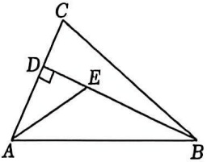

如图，在 $\triangle ABC$ 中，$BD \perp AC$ 于点 $D$，$AE$ 是 $\angle CAB$ 的角平分线，交 $BD$ 于点 $E$，$\angle AED=60^{\circ}$，$\angle CBA=40^{\circ}$，求 $\angle C$ 的度数。

> [!question]- 点击查看答案与解析
> **【答案】** $\angle C=80^{\circ}$
> 
> **【考点】** 三角形内角和定理、角平分线的性质、垂直的性质 → [[【初中数学知识点体系-人教版】#13-3 三角形的内角与外角]]
> 
> **【解析】**
> 因为 $BD \perp AC$，所以 $\angle BDA=\angle BDC=90^{\circ}$。
> 在 $\triangle AED$ 中，$\angle AED=60^{\circ}$，$\angle ADE=90^{\circ}$，
> 所以 $\angle DAE=180^{\circ}-90^{\circ}-60^{\circ}=30^{\circ}$。
> 因为 $AE$ 是 $\angle CAB$ 的角平分线，
> 所以 $\angle CAB=2 \angle DAE=2 \times 30^{\circ}=60^{\circ}$。
> 在 $\triangle ABC$ 中，$\angle CBA=40^{\circ}$，$\angle CAB=60^{\circ}$，
> 所以 $\angle C=180^{\circ}-\angle CAB-\angle CBA=180^{\circ}-60^{\circ}-40^{\circ}=80^{\circ}$。
> 
> **【易错点】** 角平分线性质的应用，三角形内角和的计算，垂直条件的运用
