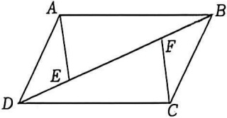

如图，在四边形 ABCD 中，$AB \parallel CD$，在 BD 上取两点 E, F，使 DF = BE，连接 AE，CF.

（1）若 $AE // CF$，试说明 $\triangle ABE \cong \triangle CDF$；

（2）在（1）的条件下，连接AF，CE，试判断AF与CE有怎样的数量关系，并说明理由.

> [!question]- 点击查看答案与解析
> **【答案】** （1）证明见解析；（2）$AF=CE$
> 
> **【考点】** 三角形全等的判定与性质、平行线的性质 → [[【初中数学知识点体系-人教版】#14-2 三角形全等的判定]]
> 
> **【解析】**
> （1）证明 $\triangle ABE \cong \triangle CDF$：
> 因为 $AB \parallel CD$，所以 $\angle ABE=\angle CDF$（两直线平行，内错角相等）。
> 因为 $AE \parallel CF$，所以 $\angle AEB=\angle CFD$（两直线平行，内错角相等）。
> 因为 $BE=DF$，
> 所以 $\triangle ABE \cong \triangle CDF$（AAS）。
> （2）$AF=CE$。
> 理由：由（1）知 $\triangle ABE \cong \triangle CDF$，
> 所以 $AE=CF$，$AB=CD$。
> 因为 $AE \parallel CF$ 且 $AE=CF$，
> 所以四边形 $AECF$ 是平行四边形（一组对边平行且相等的四边形是平行四边形）。
> 所以 $AF=CE$（平行四边形的对边相等）。
> 
> **【易错点】** 全等三角形判定条件的选择，平行四边形性质的应用
