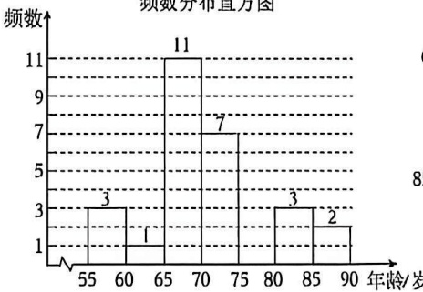
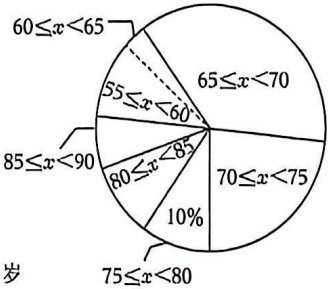

华罗庚先生是中国著名数学家．为激励中国数学家在发展中国数学事业中做出突出贡献设立了"华罗庚数学奖"。小聪对截止到2023年第十六届"华罗庚数学奖"得主获奖时的年龄（单位：岁）进行收集、整理，绘制成如下的频数分布表，频数分布直方图和扇形统计图。

| 年龄分组 | 55≤x&lt;60 | 60≤x&lt;65 | 65≤x&lt;70 | 70≤x&lt;75 | 75≤x&lt;80 | 80≤x&lt;85 | 85≤x&lt;90 |
|---|---|---|---|---|---|---|---|
| 频数 | 3 | 1 | 11 | 7 | m | 3 | 2 |

"华罗庚数学奖"得主获奖年龄频数分布直方图

"华罗庚数学奖"得主获奖年龄扇形统计图

根据以上信息，回答下列问题：

（1）写出 $m$ 的值是 ___ ，截止到第十六届共有 ___ 人获得"华罗庚数学奖"；

（2）补全"华罗庚数学奖"得主获奖年龄频数分布直方图：

（3）第十六届"华罗庚数学奖"得主徐宗本院士获奖时的年龄为 68 岁，他的获奖年龄比一半以上"华罗庚数学奖"得主获奖年龄 ___ （填"小"或"大"），理由是 ___ .

> [!question]- 点击查看答案与解析
> **【答案】** （1）$m=3$，共 30 人；（2）补全直方图略；（3）大
> 
> **【考点】** 频数分布表、频数分布直方图、扇形统计图、中位数 → [[【初中数学知识点体系-人教版】#12-1 统计调查]]
> 
> **【解析】**
> （1）从扇形统计图可以看出，$65 \leqslant x < 70$ 这一组占 $36.7\%$，频数为 11。
> 总人数 $=11 \div 36.7\% \approx 30$ 人。
> 各组频数之和 $=3 + 1 + 11 + 7 + m + 3 + 2=27 + m$。
> 所以 $27 + m=30$，$m=3$。
> （2）补全直方图：$75 \leqslant x < 80$ 这一组的频数为 3，画出相应高度的矩形。
> （3）徐宗本院士 68 岁，在 $65 \leqslant x < 70$ 这一组。
> 中位数是第 15 和第 16 个数据的平均数。
> 前两组（$55 \leqslant x < 65$）共 $3 + 1=4$ 人；
> 前三组（$55 \leqslant x < 70$）共 $4 + 11=15$ 人；
> 所以中位数在 $65 \leqslant x < 70$ 这一组。
> 68 岁在这一组中偏大，比一半以上的人年龄大。
> 
> **【易错点】** 扇形统计图与频数分布表的结合，中位数的确定，数据的分析
