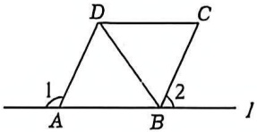

已知：如图，$A$，$B$ 是直线 $l$ 上两点，$\mathit{AB} // \mathit{CD}$，连接 $\mathit{AD}$，$\mathit{BD}$，$\mathit{BC}$，若 $BD$ 平分 $\angle ABC$，$\angle 1 + \angle 2 = 180^\circ$。

（1）请你猜想 AD 与 BC 的位置关系，并证明：

（2）若 $\angle DAB = \alpha$，求 $\angle CDB$ 的大小（用含 $\alpha$ 的式子表示）.

> [!question]- 点击查看答案与解析
> 【答案】（1）$AD \parallel BC$；（2）$\angle CDB=90^{\circ}-\dfrac{\alpha}{2}$
> 
> 【考点】平行线的判定与性质、角平分线的性质、三角形内角和 → [[【初中数学知识点体系-人教版】#7-2 平行线]]
> 
> 【解析】
> （1）猜想：$AD \parallel BC$。
> 证明：因为 $\angle 1 + \angle 2=180^{\circ}$，且 $\angle 1$ 和 $\angle 2$ 是同旁内角，
> 所以 $AD \parallel BC$（同旁内角互补，两直线平行）。
> （2）因为 $AB \parallel CD$，所以 $\angle ABC + \angle BCD=180^{\circ}$。
> 因为 $BD$ 平分 $\angle ABC$，所以 $\angle ABD=\angle DBC=\dfrac{1}{2} \angle ABC$。
> 因为 $AD \parallel BC$，所以 $\angle ADB=\angle DBC$（内错角相等）。
> 在 $\triangle ABD$ 中，$\angle DAB + \angle ABD + \angle ADB=180^{\circ}$。
> $\alpha + \dfrac{1}{2} \angle ABC + \dfrac{1}{2} \angle ABC=180^{\circ}$。
> $\alpha + \angle ABC=180^{\circ}$。
> $\angle ABC=180^{\circ}-\alpha$。
> 因为 $AB \parallel CD$，$\angle BCD=180^{\circ}-\angle ABC=180^{\circ}-(180^{\circ}-\alpha)=\alpha$。
> 在 $\triangle BCD$ 中，$\angle CDB=180^{\circ}-\angle DBC-\angle BCD$。
> $\angle DBC=\dfrac{1}{2} \angle ABC=\dfrac{1}{2}(180^{\circ}-\alpha)=90^{\circ}-\dfrac{\alpha}{2}$。
> $\angle CDB=180^{\circ}-(90^{\circ}-\dfrac{\alpha}{2})-\alpha=180^{\circ}-90^{\circ}+\dfrac{\alpha}{2}-\alpha=90^{\circ}-\dfrac{\alpha}{2}$。
> 
> 【易错点】平行线判定与性质的综合运用，角平分线性质的应用，代数式的化简
