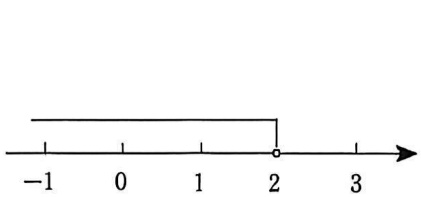

如图，在数轴上表示的 x 的取值范围是( )

A. $x < 2$

B. $x \leq 2$

C. $x > 2$

D. $x \geq 2$

> [!question]- 点击查看答案与解析
> **【答案】** B
> 
> **【考点】** 数轴上不等式的表示 → [[【初中数学知识点体系-人教版】#1-2 有理数及其大小比较]]
> 
> **【解析】**
> - 选项A：$x<2$ 表示不包含2，数轴上应为空心圆点，错误；
> - 选项B：$x\leq2$ 表示包含2，数轴上为实心圆点且向左画线，正确；
> - 选项C：$x>2$ 表示大于2，方向错误；
> - 选项D：$x\geq2$ 表示大于等于2，方向错误。
> 
> **【易错点】** 混淆实心圆点（包含）与空心圆点（不包含）的含义，以及数轴方向与不等号方向的对应关系。
