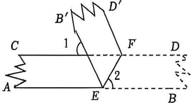

如图，纸片的边缘 AB，CD 互相平行，将纸片沿 EF 折叠，使得点 B，D 分别落在点 $B'$，$D'$ 处。若 $\angle1=80^{\circ}$，则 $\angle2$ 的度数是（ ）

A. $50^{\circ}$

B. $60^{\circ}$

C. $70^{\circ}$

D. $80^{\circ}$

> [!question]- 点击查看答案与解析
> **【答案】** A
> 
> **【考点】** 平行线的性质、折叠的性质 → [[【初中数学知识点体系-人教版】#7-2 平行线]]
> 
> **【解析】**
> - 由折叠性质可知：$\angle BEF=\angle B'EF$
> - $\angle1+\angle BEF+\angle B'EF=180^{\circ}$（平角）
> - $\angle BEF=\angle B'EF=\frac{180^{\circ}-80^{\circ}}{2}=50^{\circ}$
> - 因为$AB\parallel CD$，所以$\angle2=\angle BEF=50^{\circ}$（内错角相等）
> - 选项A：$50^{\circ}$，正确；
> - 选项B：$60^{\circ}$，计算错误；
> - 选项C：$70^{\circ}$，计算错误；
> - 选项D：$80^{\circ}$，未考虑折叠性质。
> 
> **【易错点】** 忽略折叠的对称性，未正确利用平行线的内错角关系。
