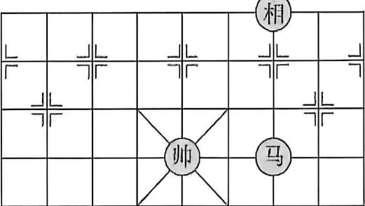

中国象棋中的"马"沿"日"形对角线走，俗称马走日．三个棋子位置如图，若建立平面直角坐标系，使帅、相所在点的坐标分别为 $(-1,-1)$，$(1,2)$，则马直接走到第一象限时所在点的坐标是( )

A. (0,1)

B. (3,0)

C. (2,1)

D. (1,2)

> [!question]- 点击查看答案与解析
> **【答案】** C
> 
> **【考点】** 平面直角坐标系的建立、马走日的规则 → [[【初中数学知识点体系-人教版】#9-1 用坐标描述平面内点的位置]]
> 
> **【解析】**
> - 由帅$(-1,-1)$、相$(1,2)$建立坐标系
> - 马走"日"字，即横向走2格纵向走1格，或横向走1格纵向走2格
> - 从图中马的位置出发，走到第一象限的坐标为$(2,1)$
> - 选项A：$(0,1)$不在第一象限；
> - 选项B：$(3,0)$在x轴上，不属于任何象限；
> - 选项C：$(2,1)$在第一象限，正确；
> - 选项D：$(1,2)$是相的位置。
> 
> **【易错点】** 坐标系建立错误，或对"马走日"的规则理解不准确。
