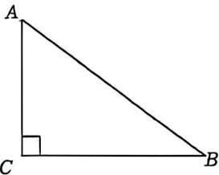

如图，在三角形 $\angle C = 90^{\circ}$，$AC = 3$，$BC = 4$，$AB = 5$，则点 $A$ 到 $BC$ 的距离等于 ___ .

> [!question]- 点击查看答案与解析
> **【答案】** 3
> 
> **【考点】** 点到直线的距离 → [[【初中数学知识点体系-人教版】#13-2 与三角形有关的线段]]
> 
> **【解析】**
> - 在直角三角形中，$\angle C=90^{\circ}$
> - $AC=3$，$BC=4$，$AB=5$
> - 点$A$到$BC$的距离就是$AC$的长度（因为$AC\perp BC$）
> - 所以距离等于$3$
> 
> **【易错点】** 混淆点到直线的距离与点到点的距离，或误用勾股定理。
