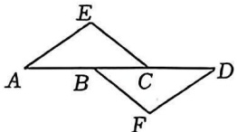

如图，$\triangle ACE \cong \triangle DBF$，若 $AC=6$，$DF=3$，$EC=4$，则 $\triangle BDF$ 的周长等于 ___ .

> [!question]- 点击查看答案与解析
> **【答案】** 13
> 
> **【考点】** 全等三角形的性质 → [[【初中数学知识点体系-人教版】#14-1 全等三角形及其性质]]
> 
> **【解析】**
> - $\triangle ACE\cong\triangle DBF$
> - 由全等可知：$AC=DB=6$，$DF=AE=3$，$EC=FB=4$
> - $\triangle BDF$的周长$=BD+DF+FB=6+3+4=13$
> 
> **【易错点】** 未正确找出全等三角形的对应边，或计算周长时遗漏某条边。
