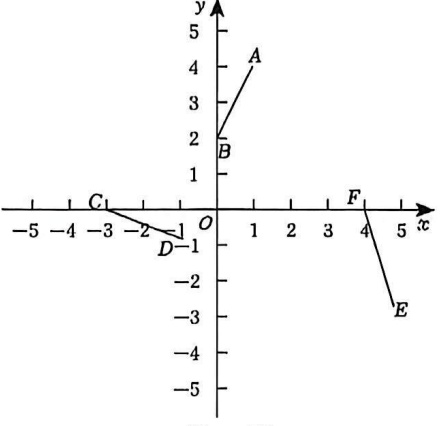

如图，在平面直角坐标系 xOy 中，已知点 $A(1,4)$，$B(0,2)$，$C(-3,0)$，$D(-1,-1)$，$E(5,-3)$，$F(4,0)$。将线段 AB，CD，EF 沿 x 轴或 y 轴方向平移后，恰好组成一个首尾相接的三角形。若点 B 与点 C 平移后的对应点均为点 O，则线段 EF 需先向左平移 ___ 个单位长度，再向上平移 ___ 个单位长度。

> [!question]- 点击查看答案与解析
> **【答案】** 3；2
> 
> **【考点】** 平移的性质 → [[【初中数学知识点体系-人教版】#7-4 平移]]
> 
> **【解析】**
> - $B(0,2)$ 平移到 $O(0,0)$，平移向量为 $(0,-2)$
> - $A(1,4)$ 平移后为 $A'(1,2)$
> - $C(-3,0)$ 平移到 $O(0,0)$，平移向量为 $(3,0)$
> - $D(-1,-1)$ 平移后为 $D'(2,-1)$
> - $E(5,-3)$，$F(4,0)$ 需要平移到 $D'$ 和 $A'$
> - $E(5,-3)\to E'(2,-1)$，平移向量为 $(-3,2)$
> - $F(4,0)\to F'(1,2)$，平移向量为 $(-3,2)$
> - 所以 $EF$ 先向左平移 $3$ 个单位，再向上平移 $2$ 个单位
> 
> **【易错点】** 未正确计算平移向量，或混淆平移方向。
