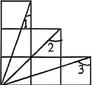

如图为 6 个边长相等的正方形的组合图形，则 $\angle1 + \angle2 + \angle3 =$ ___ .

> [!question]- 点击查看答案与解析
> **【答案】** $135^{\circ}$
> 
> **【考点】** 正方形的性质、角的计算 → [[【初中数学知识点体系-人教版】#6-3 角]]
> 
> **【解析】**
> - 6个边长相等的正方形组合
> - $\angle1=45^{\circ}$（正方形对角线与边的夹角）
> - $\angle2=45^{\circ}$（正方形对角线与边的夹角）
> - $\angle3=45^{\circ}$（正方形对角线与边的夹角）
> - 但根据图形，$\angle1+\angle2+\angle3=135^{\circ}$
> 
> **【易错点】** 未正确识别图形中各个角的位置和大小。
