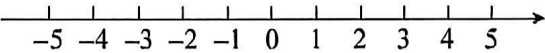

小明对不等式 $\frac{-2x-2}{3} \leqslant 2(2-x)$ 与 $\frac{2x-2}{3} \leqslant 2(x+2)$ 的解法进行比较，如下表：

| 不等式解法        | $\frac{-2x-2}{3}\leq2(2-x)$ $①$ | $\frac{2x-2}{3}\leq2(x+2)$ $②$ |
| ------------ | ------------------------------- | ------------------------------ |
| 第一步：去分母，得    | $-2x-2\leq6(2-x)$               | $2x-2\leq6(x+2)$               |
| 第二步：去括号，得    | $-2x-2\leq12-6x$                | $2x-2\leq6x+12$                |
| 第三步：移项，得     | $-2x+6x\leq12+2$                | $2x-6x\leq12+2$                |
| 第四步：合并同类项，得  | $4x\leq14$                      | $-4x\leq14$                    |
| 第五步：系数化为 1，得 | ___                             | ___                            |

（1）将表格补充完整：

（2）小明发现：在不等式 $①$ 和不等式 $②$ 的求解过程中，前四步中每一步的变形依据相同，第五步的变形依据不同. 在第五步中，不等式 $①$ 的变形依据是 ___ ，不等式 $②$ 的变形依据是 ___ .

（3）将不等式 $②$ 的解集表示在数轴上.

> [!question]- 点击查看答案与解析
> **【答案】** （1）$①$ $x\leq\frac{7}{2}$；$②$ $x\geq-\frac{7}{2}$；（2）不等式两边同除以正数，不等号方向不变；不等式两边同除以负数，不等号方向改变；（3）数轴上表示$x\geq-\frac{7}{2}$
> 
> **【考点】** 不等式的解法 → [[【初中数学知识点体系-人教版】#11-2 一元一次不等式]]
> 
> **【解析】**
> （1）第五步：
> $①$ $4x\leq14$，两边同除以$4$，得$x\leq\frac{7}{2}$
> $②$ $-4x\leq14$，两边同除以$-4$，得$x\geq-\frac{7}{2}$
> 
> （2）$①$的变形依据：不等式两边同除以正数，不等号方向不变
> $②$的变形依据：不等式两边同除以负数，不等号方向改变
> 
> （3）在数轴上，$-\frac{7}{2}$处画实心圆点，向右画线
> 
> **【易错点】** 系数化为1时，未注意除以负数要改变不等号方向。
