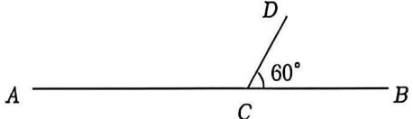

下面是小红设计的"过直线外一点作这条直线的平行线"的作图过程.

已知：点 C 在直线 AB 上，点 D 在直线 AB 外，且 $\angle DCB = 60^{\circ}$ 求作：直线DE，使得 DE//AB.

作法：如图，

 

$①$ 在线段 CD 的延长线上任取一点 M；

$②$ 以 D 为顶点，DM 为一边，通过量角器度量，在 DM 右侧作 $\angle MDE=60^{\circ}$ ; 

$③$ 将射线 DE 反向延长.

直线 DE 就是所求作的直线.

根据小红的作图过程，解决以下问题：

（1）补全图形，并完成证明过程：

证明：∵ $\angle MDE=60^{\circ}$，$\angle DCB=60^{\circ}$，

$\therefore\angle MDE=\angle DCB.$ 

$\therefore DE \parallel AB$ ( ___ ）(填推理的依据).

（2）在（1）的条件下，过点 C 作 CD 的垂线，交直线 DE 于点 F．求 $\angle CFE$ 的度数.

> [!question]- 点击查看答案与解析
> **【答案】** （1）同位角相等，两直线平行；（2）$30^{\circ}$
> 
> **【考点】** 平行线的判定、三角形内角和 → [[【初中数学知识点体系-人教版】#7-2 平行线]]
> 
> **【解析】**
> （1）证明：
> $\because \angle MDE=60^{\circ}$，$\angle DCB=60^{\circ}$
> $\therefore \angle MDE=\angle DCB$
> $\therefore DE\parallel AB$（同位角相等，两直线平行）
> 
> （2）$\because DE\parallel AB$
> $\therefore \angle CDF=\angle DCB=60^{\circ}$（内错角相等）
> $\because CF\perp CD$
> $\therefore \angle DCF=90^{\circ}$
> 在$\triangle DCF$中：
> $\angle CFE=180^{\circ}-\angle DCF-\angle CDF=180^{\circ}-90^{\circ}-60^{\circ}=30^{\circ}$
> 
> **【易错点】** 未正确识别同位角或内错角，或在计算角度时遗漏某个角。
