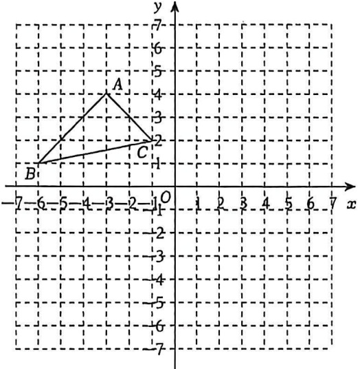

如图，在平面直角坐标系 xOy 中，已知点 $A(-3,4)$，$B(-6,1)$，$C(-1,2)$，将三角形 ABC 先向右平移 6 个单位，再向上平移 1 个单位后得到三角形 $A_1B_1C_1$。

（1）在图中画出三角形 $A_{1}B_{1}C_{1}$，并写出点 $A_{1}$ 的坐标；

（2）直接写出三角形 $A_{1}B_{1}C_{1}$ 的面积；

（3）若点 P 在 y 轴上，三角形 $A_{1}B_{1}P$ 的面积是 1，直接写出点 P 的坐标.

> [!question]- 点击查看答案与解析
> **【答案】** （1）$A_1(3,5)$；（2）$6$；（3）$P(0,\frac{8}{3})$或$P(0,\frac{4}{3})$
> 
> **【考点】** 平移的性质、三角形面积 → [[【初中数学知识点体系-人教版】#7-4 平移]]
> 
> **【解析】**
> （1）向右平移$6$个单位，向上平移$1$个单位：
> $A(-3,4)\to A_1(-3+6,4+1)=(3,5)$
> $B(-6,1)\to B_1(0,2)$
> $C(-1,2)\to C_1(5,3)$
> 
> （2）用坐标公式求面积：
> $S=\frac{1}{2}|x_1(y_2-y_3)+x_2(y_3-y_1)+x_3(y_1-y_2)|$
> $=\frac{1}{2}|3(2-3)+0(3-5)+5(5-2)|$
> $=\frac{1}{2}|-3+0+15|=\frac{1}{2}\times12=6$
> 
> （3）设$P(0,p)$
> $A_1(3,5)$，$B_1(0,2)$
> 底$B_1P=|p-2|$，高$=3$（$A_1$到$y$轴的距离）
> $S=\frac{1}{2}\times|p-2|\times3=1$
> $|p-2|=\frac{2}{3}$
> $p=2+\frac{2}{3}=\frac{8}{3}$或$p=2-\frac{2}{3}=\frac{4}{3}$
> 所以$P(0,\frac{8}{3})$或$P(0,\frac{4}{3})$
> 
> **【易错点】** 平移时坐标计算出错，或用割补法求面积时遗漏某个三角形。
