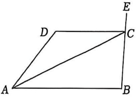

如图，AC 平分 $\angle DAB$，且 $\angle DAB + \angle D = 180^\circ$，点 $E$ 在射线 $BC$ 上。若 $\angle B = 95^\circ$，$\angle CAD = 25^\circ$，求 $\angle DCA$ 和 $\angle DCE$ 的度数。

> [!question]- 点击查看答案与解析
> **【答案】** $\angle DCA=25^{\circ}$；$\angle DCE=95^{\circ}$
> 
> **【考点】** 角平分线的性质、平行线的判定与性质 → [[【初中数学知识点体系-人教版】#14-3 角的平分线]]
> 
> **【解析】**
> $\because AC$平分$\angle DAB$，$\angle CAD=25^{\circ}$
> $\therefore \angle DAB=2\times25^{\circ}=50^{\circ}$
> 
> $\because \angle DAB+\angle D=180^{\circ}$
> $\therefore \angle D=180^{\circ}-50^{\circ}=130^{\circ}$
> 
> 在$\triangle ACD$中：
> $\angle DCA=180^{\circ}-\angle D-\angle CAD=180^{\circ}-130^{\circ}-25^{\circ}=25^{\circ}$
> 
> $\because \angle DAB+\angle D=180^{\circ}$
> $\therefore AB\parallel DC$（同旁内角互补，两直线平行）
> 
> $\therefore \angle DCE=\angle B=95^{\circ}$（两直线平行，同位角相等）
> 
> **【易错点】** 未正确利用角平分线性质，或忽略平行线的判定与性质。
