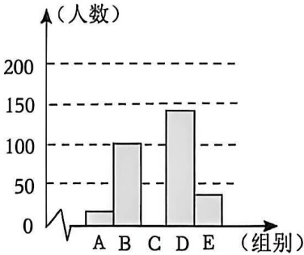
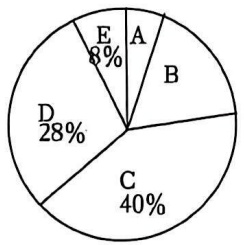

阅读可以增进人们的知识也能陶冶人们的情操. 我们要多阅读, 多阅读有营养的书. 因此我校对学生的课外阅读时间进行了抽样调查, 将收集的数据分成 A、B、C、D、E 五组进行整理, 整理后的数据如下表 (表中信息不完整). 图1和图2是根据整理后的数据绘制的两幅不完整的统计图.

| 阅读时间分组统计表 |  |  |
|---|---|---|
| 组别 | 阅读时间 x(h) | 人数 |
| A | 0≤x&lt;10 | a |
| B | 10≤x&lt;20 | 100 |
| C | 20≤x&lt;30 | b |
| D | 30≤x&lt;40 | 140 |
| E | x≥40 | c |

阅读人数分组统计图 

阅读时间分组统计图 

请结合以上信息解答下列问题：

（1）求 a，b，c 的值：

（2）补全图1所对应的统计图：

（3）估计全校课外阅读时间在 20h 以下（不含 20h）的学生所占百分比.

> [!question]- 点击查看答案与解析
> **【答案】** （1）$a=60$，$b=120$，$c=80$；（2）补全统计图；（3）$32\%$
> 
> **【考点】** 统计图表的分析 → [[【初中数学知识点体系-人教版】#12-1 统计调查]]
> 
> **【解析】**
> （1）从扇形图可知，$D$组占$28\%$，$D$组$140$人
> 总人数$N=\frac{140}{28\%}=500$
> 
> $B$组$100$人，占$\frac{100}{500}=20\%$
> 
> $A$组$a$人，$C$组$b$人，$E$组$c$人
> $a+b+c=500-100-140=260$
> 
> 从条形图读取：$a=60$，$b=120$，$c=80$
> 
> （2）补全条形统计图，$A$组$60$人，$C$组$120$人，$E$组$80$人
> 
> （3）$20h$以下：$A$组$+B$组$=60+100=160$人
> 百分比$=\frac{160}{500}\times100\%=32\%$
> 
> **【易错点】** 未正确从统计图中读取数据，或计算百分比时出错。
