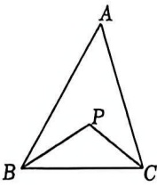
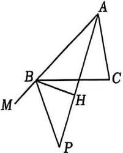
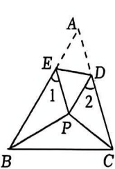

【问题再现】

（1）如图 $①$，在 $\triangle ABC$ 中，$\angle ABC$、$\angle ACB$ 的平分线交于点 $P$，若 $\angle A=50^\circ$，则 $\angle P=$ ___ 度；

【问题推广】

（2）如图 $②$，在 $\triangle ABC$ 中，$\angle BAC$ 的平分线与 $\triangle ABC$ 的外角 $\angle CBM$ 的平分线交于点 $P$，过点 $B$ 作 $BH\perp AP$ 于点 $H$，若 $\angle ACB=80^{\circ}$，求 $\angle PBH$ 的度数；

（3）如图 $③$，在 $\triangle ABC$ 中，$\angle ABC$、$\angle ACB$ 的平分线交于点 $P$，将 $\triangle ABC$ 沿 $DE$ 折叠，使得点 $A$ 与点 $P$ 重合，若 $\angle1+\angle2=80^\circ$，则 $\angle BPC=$ ___ 度。

图1  

图2 

图3 

> [!question]- 点击查看答案与解析
> **【答案】** （1）$115$；（2）$50^{\circ}$；（3）$140$
> 
> **【考点】** 三角形内角和、角平分线的性质 → [[【初中数学知识点体系-人教版】#13-3 三角形的内角与外角]]
> 
> **【解析】**
> （1）$\because \angle A=50^{\circ}$
> $\therefore \angle ABC+\angle ACB=180^{\circ}-50^{\circ}=130^{\circ}$
> 
> $\because BP$、$CP$分别平分$\angle ABC$、$\angle ACB$
> $\therefore \angle PBC+\angle PCB=\frac{1}{2}(\angle ABC+\angle ACB)=\frac{1}{2}\times130^{\circ}=65^{\circ}$
> 
> 在$\triangle BPC$中：
> $\angle P=180^{\circ}-(\angle PBC+\angle PCB)=180^{\circ}-65^{\circ}=115^{\circ}$
> 
> （2）$\because \angle ACB=80^{\circ}$
> $\therefore \angle ABC+\angle BAC=180^{\circ}-80^{\circ}=100^{\circ}$
> 
> $\because AP$平分$\angle BAC$，$BP$平分外角$\angle CBM$
> $\angle CBM=180^{\circ}-\angle ABC$
> $\angle PBM=\frac{1}{2}\angle CBM=90^{\circ}-\frac{1}{2}\angle ABC$
> 
> $\because BH\perp AP$
> $\therefore \angle BHA=90^{\circ}$
> 
> 在$\triangle ABH$中：
> $\angle ABH=90^{\circ}-\angle BAH=90^{\circ}-\frac{1}{2}\angle BAC$
> 
> $\angle PBH=\angle PBA-\angle ABH$
> $=(90^{\circ}+\frac{1}{2}\angle ABC)-(90^{\circ}-\frac{1}{2}\angle BAC)$
> $=\frac{1}{2}(\angle ABC+\angle BAC)$
> $=\frac{1}{2}\times100^{\circ}=50^{\circ}$
> 
> （3）$\because \angle1+\angle2=80^{\circ}$
> $\therefore \angle ADE+\angle AED=80^{\circ}$
> $\therefore \angle A=180^{\circ}-80^{\circ}=100^{\circ}$
> 
> $\because BP$、$CP$分别平分$\angle ABC$、$\angle ACB$
> $\therefore \angle BPC=90^{\circ}+\frac{1}{2}\angle A=90^{\circ}+\frac{1}{2}\times100^{\circ}=140^{\circ}$
> 
> **【易错点】** 未正确利用三角形外角性质，或在角度计算时遗漏某个角。
