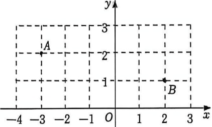

在平面直角坐标系 xOy 中，对于任意两点 M，N，给出如下定义：点 M，N 的横坐标之差的绝对值与纵坐标之差的绝对值的和叫做这两点之间的"直角距离"，记作：$d_{MN}$，即点 $M(x_1, y_1)$ 与点 $N(x_2, y_2)$ 之间的"直角距离"为 $d_{MN} = |x_1 - x_2| + |y_1 - y_2|$。已知点 $A(-3,2)$，点 $B(2,1)$。

（1）A 与 B 两点之间的"直角距离" $d_{\lambda D}=$ ___ ；

（2）点 $C(0,t)$ 为y轴上的一个动点，当t的取值范围是 ___ 时，$d_{AC}+d_{BC}$ 的值最小；

（3）若动点 P 位于第二象限，且满足 $d_{AP} \geqslant d_{BP}$，请在图中画出点 P 的运动区域（用阴影表示）.

> [!question]- 点击查看答案与解析
> **【答案】** （1）$6$；（2）$1\leq t\leq2$；（3）见解析
> 
> **【考点】** 新定义运算、绝对值的性质 → [[【初中数学知识点体系-人教版】#1-2 有理数及其大小比较]]
> 
> **【解析】**
> （1）$d_{AB}=|-3-2|+|2-1|=5+1=6$
> 
> （2）$d_{AC}=|-3-0|+|2-t|=3+|2-t|$
> $d_{BC}=|2-0|+|1-t|=2+|1-t|$
> $d_{AC}+d_{BC}=5+|2-t|+|1-t|$
> 
> 当$1\leq t\leq2$时：
> $|2-t|=2-t$，$|1-t|=t-1$
> $|2-t|+|1-t|=2-t+t-1=1$（最小值）
> 
> 所以$t$的取值范围是$1\leq t\leq2$
> 
> （3）设$P(x,y)$，$P$在第二象限，$x<0$，$y>0$
> $d_{AP}=|x+3|+|y-2|$
> $d_{BP}=|x-2|+|y-1|$
> 
> $\because x<0<2$
> $\therefore |x-2|=2-x$
> 
> 当$x\geq-3$时，$|x+3|=x+3$
> $d_{AP}=x+3+|y-2|$
> 
> 当$y\geq2$时，$|y-2|=y-2$，$|y-1|=y-1$
> $d_{AP}=x+3+y-2=x+y+1$
> $d_{BP}=2-x+y-1=1-x+y$
> $d_{AP}\geq d_{BP}$
> $x+y+1\geq1-x+y$
> $2x\geq0$
> $x\geq0$（与$x<0$矛盾，无解）
> 
> 当$y<2$时，$|y-2|=2-y$
> 若$y\geq1$，$|y-1|=y-1$
> $d_{AP}=x+3+2-y=x-y+5$
> $d_{BP}=2-x+y-1=1-x+y$
> $x-y+5\geq1-x+y$
> $2x-2y\geq-4$
> $x-y\geq-2$
> $y\leq x+2$
> 
> 所以$P$的运动区域为第二象限内满足$y\leq x+2$的部分（$x<0$，$y>0$）
> 
> 用阴影表示：在第二象限内，画出直线$y=x+2$，阴影部分为该直线下方、$x$轴上方、$y$轴左侧的区域。
> 
> **【易错点】** 未正确理解"直角距离"的新定义，或在分情况讨论绝对值时遗漏某种情况。
