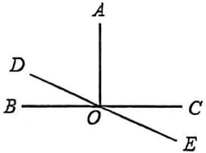

如图，O 是 BC 上一点，$AO \perp BC$ 于点 O，直线 DE 经过 O 点，$\angle BOD = 25^\circ$，则 $\angle AOE$ 的度数为 ( )

A. $100^\circ$

B. $105^\circ$

C. $115^\circ$

D. $125^\circ$

> [!question]- 点击查看答案与解析
> **【答案】** C
> **【考点】** 垂直的定义、平角的性质 → [[【初中数学知识点体系-人教版】#7-1 相交线]]、角的计算 → [[【初中数学知识点体系-人教版】#6-3 角]]
> **【解析】** 因为 $AO\perp BC$ 于点 $O$，所以 $\angle AOB=90^\circ$。因为 $\angle BOD=25^\circ$，所以 $\angle AOD=\angle AOB-\angle BOD=90^\circ-25^\circ=65^\circ$。因为直线 $DE$ 经过点 $O$，所以 $\angle DOE$ 是平角，即 $\angle AOD+\angle AOE=180^\circ$。所以 $\angle AOE=180^\circ-\angle AOD=180^\circ-65^\circ=115^\circ$。
> **【易错点】** 不能正确利用垂直关系求出 $\angle AOD$，或在计算 $\angle AOE$ 时忽略了平角为 $180^\circ$ 的条件。
