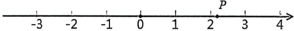

数轴上点 P 表示的数可能是 ( )

A. $\sqrt{5}$

B. $\sqrt{10}$

C. $\sqrt{3}$

D. $\sqrt{2}$

> [!question]- 点击查看答案与解析
> **【答案】** B
> **【考点】** 无理数的估算、数轴 → [[【初中数学知识点体系-人教版】#8-3 实数及其简单运算]]
> **【解析】** 根据数轴，点 $P$ 表示的数大约在 3 到 4 之间。对各选项进行估算：A 选项：$\sqrt{5}\approx2.24$，在 2 和 3 之间，不符合；B 选项：$\sqrt{10}\approx3.16$，在 3 和 4 之间，符合；C 选项：$\sqrt{3}\approx1.73$，在 1 和 2 之间，不符合；D 选项：$\sqrt{2}\approx1.41$，在 1 和 2 之间，不符合。因此点 $P$ 表示的数可能是 $\sqrt{10}$。
> **【易错点】** 不能正确估算各无理数的大小，需要熟记常见平方根的近似值。
