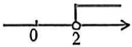
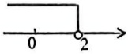
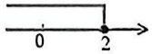
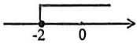

不等式 $x - 3 \leq 3x + 1$ 的解集在数轴上表示正确的是 ( )

A.

B.

C.

D.

> [!question]- 点击查看答案与解析
> **【答案】** C
> **【考点】** 一元一次不等式的解法、数轴表示 → [[【初中数学知识点体系-人教版】#11-2 一元一次不等式]]
> **【解析】** 解不等式 $x-3\leq3x+1$：移项得 $x-3x\leq1+3$，合并同类项得 $-2x\leq4$，两边同除以 $-2$（注意变号）得 $x\geq-2$。在数轴上表示 $x\geq-2$：在 $-2$ 处画实心圆点（因为含等号），向右画线。
> **【易错点】** 解不等式时两边同除以负数忘记变号，或在数轴上表示时混淆实心圆点与空心圆点的使用。
