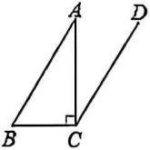

如图，在 $\triangle ABC$ 中，$\angle ACB=90^{\circ}$，$CD \parallel AB$，$\angle ACD=36^{\circ}$，那么 $\angle B$ 的度数为 ( )

A. $144^{\circ}$

B. $54^{\circ}$

C. $44^{\circ}$

D. $36^{\circ}$

> [!question]- 点击查看答案与解析
> **【答案】** B
> **【考点】** 平行线的性质 → [[【初中数学知识点体系-人教版】#7-2 平行线]]、三角形内角和 → [[【初中数学知识点体系-人教版】#13-3 三角形的内角与外角]]
> **【解析】** 因为 $CD\parallel AB$，根据两直线平行，内错角相等，得 $\angle A=\angle ACD=36^\circ$。在 $\triangle ABC$ 中，$\angle ACB=90^\circ$，$\angle A=36^\circ$，由三角形内角和为 $180^\circ$，得 $\angle B=180^\circ-\angle ACB-\angle A=180^\circ-90^\circ-36^\circ=54^\circ$。
> **【易错点】** 不能正确利用平行线的性质找到 $\angle A$ 与 $\angle ACD$ 的关系，或在三角形内角和计算中出错。
