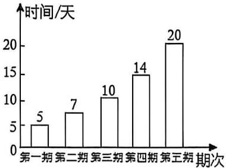
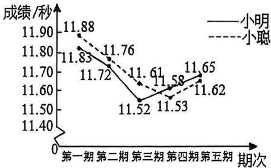

小明、小聪参加了100m 跑的 5 期集训，每期集训结束时进行测试，根据他们的集训时间、测试成绩绘制成如图两个统计图。

1-5期每期的集训时间统计图 

1-5期每期小明、小聪测试成绩统计图 

根据图中信息，有下面四个推断：

$①$ 这 5 期的集训共有 56 天：

$②$ 小明 5 次测试的平均成绩是 11.68 秒；

$③$ 从集训时间看，集训时间不是越多越好，集训时间过长，可能造成劳累，导致成绩下滑；

$④$ 从测试成绩看，两人的最好成绩都是在第4期出现，建议集训时间定为14天。

所有合理推断的序号是 ( )

A. $①③$

B. $②④$

C. $②③$

D. $①④$

> [!question]- 点击查看答案与解析
> **【答案】** C
> **【考点】** 统计图表的阅读与分析 → [[【初中数学知识点体系-人教版】#12-1 统计调查]]、平均数 → [[【初中数学知识点体系-人教版】#12-2 用统计图描述数据]]
> **【解析】** 逐一分析四个推断：$①$ 根据集训时间统计图，将 5 期集训的天数相加，总天数不等于 56 天，该推断不合理；$②$ 根据测试成绩统计图，读取小明 5 次测试的成绩并求平均值，计算结果为 11.68 秒，该推断合理；$③$ 从集训时间与成绩的变化趋势来看，集训时间过长（如第 5 期）反而可能导致成绩下滑，说明集训时间不是越多越好，该推断合理；$④$ 虽然两人的较好成绩在第 4 期出现，但不能据此简单地建议集训时间定为 14 天，还需综合考虑其他因素，该推断不合理。综上所述，合理推断为 $②③$。
> **【易错点】** 不能准确从统计图中读取数据进行分析，或对推断结论的判断过于主观。
