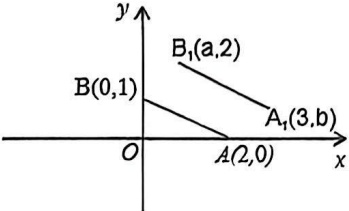

如图，$A$，$B$ 的坐标为 $(2,0)$，$(0,1)$ 若将线段 $AB$ 平移至 $A_1B_1$，则 $a+b$ 的值为 ___ 。

> [!question]- 点击查看答案与解析
> **【答案】** 6
> **【考点】** 平移的性质 → [[【初中数学知识点体系-人教版】#7-4 平移]]、坐标与图形 → [[【初中数学知识点体系-人教版】#9-2 坐标方法的简单应用]]
> **【解析】** 由图可知，$A(2,0)$，$B(0,1)$，平移后 $A_1(a,2)$，$B_1(1,b)$。由平移的性质，对应点的平移向量相同：$A\to A_1$：纵坐标从 $0$ 变为 $2$，所以平移向量的纵分量为 $2$；$B\to B_1$：横坐标从 $0$ 变为 $1$，所以平移向量的横分量为 $1$。因此平移向量为 $(1,2)$。$A_1=(2+1,0+2)=(3,2)$，所以 $a=3$；$B_1=(0+1,1+2)=(1,3)$，所以 $b=3$。因此 $a+b=3+3=6$。
> **【易错点】** 不能正确从图中读取 $A_1$、$B_1$ 的坐标，或不理解平移向量相等的性质。
