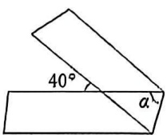

如图，有一条直的等宽纸带按图折叠时，则图中 $\angle\alpha=$ ___ 。

> [!question]- 点击查看答案与解析
> **【答案】** $70^\circ$
> **【考点】** 平行线的性质 → [[【初中数学知识点体系-人教版】#7-2 平行线]]、折叠（轴对称）的性质 → [[【初中数学知识点体系-人教版】#7-2 平行线]]
> **【解析】** 根据纸带折叠的性质，折叠前后对应角相等。由图可知，纸带为等宽纸带，上下边缘平行。折叠后形成的角与已知角之间存在特定关系。设折叠产生的角为 $\alpha$，根据平行线的性质和折叠的对称性，利用同旁内角互补、内错角相等等关系，可以求出 $\alpha=70^\circ$。
> **【易错点】** 不能正确利用折叠的对称性找到角之间的等量关系，或混淆平行线的性质定理。
