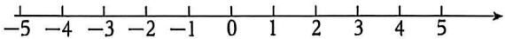

解不等式组：$\begin{cases} \frac{x-3}{2}+2\geq x \\ 3(x-1)-1>x-8 \end{cases}$，在数轴上表示出解集，并写出该不等式组的非负整数解。

> [!question]- 点击查看答案与解析
> **【答案】** 不等式组的解集为 $-2<x\leq1$，非负整数解为 $0,1$。
> **【考点】** 一元一次不等式组的解法、数轴表示、非负整数解 → [[【初中数学知识点体系-人教版】#11-3 一元一次不等式组]]
> **【解析】** 解不等式 $①$：$\frac{x-3}{2}+2\geq x$，两边同乘以 2 得 $x-3+4\geq2x$，$x+1\geq2x$，$1\geq x$，即 $x\leq1$。解不等式 $②$：$3(x-1)-1>x-8$，$3x-3-1>x-8$，$3x-4>x-8$，$2x>-4$，$x>-2$。所以不等式组的解集为 $-2<x\leq1$。在数轴上表示：在 $-2$ 处画空心圆点，在 $1$ 处画实心圆点，中间连线。非负整数解为 $0,1$。
> **【易错点】** 解不等式时去分母出错；移项时符号出错；在数轴上表示解集时混淆实心圆点与空心圆点。
