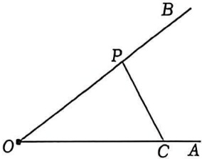

如图，点 P 是 $\angle AOB$ 的边 OB 上的一点，

（1）过点 P 作 OB 的垂线，交 OA 于点 C；

（2）在（1）的基础上作 $\triangle OPC$ 的边 $OC$ 上的高，垂足为 $H$；

（3）线段 ___ 的长度是点 P 到直线 OA 的距离；

（4）线段 PC、PH 这两条线段大小关系是 ___ （用"<"号连接）。

> [!question]- 点击查看答案与解析
> **【答案】** （3）线段 PH 的长度；（4）PH < PC
> **【考点】** 垂线的性质 → [[【初中数学知识点体系-人教版】#7-1 相交线]]、点到直线的距离 → [[【初中数学知识点体系-人教版】#7-1 相交线]]
> **【解析】** （3）点到直线的距离是指从该点到直线的垂线段的长度。因为 $PH\perp OC$ 于点 $H$，所以线段 PH 的长度是点 P 到直线 OA 的距离。（4）在 $\triangle OPC$ 中，$\angle OPC=90^\circ$（因为 $PC\perp OB$），$PH\perp OC$，所以 PH 是 $\triangle OPC$ 中 OC 边上的高。因为直角三角形中，斜边大于直角边，所以 $PC>PH$，即 $PH<PC$。
> **【易错点】** 混淆点到直线距离的概念；不能正确理解垂线段最短的性质。
