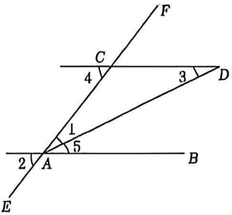

推理填空：如图，直线 $AB$，$CD$ 被直线 $EF$ 所截，$AD$ 是 $\angle CAB$ 的角平分线，若 $\angle 3 = \angle 1$，$\angle 2 = 50^\circ$ 求 $\angle 4$ 的度数。

解：∵直线 AB 与直线 EF 相交，

$\therefore \angle 2 = \angle CAB = 50^{\circ}$。（ ___ ）

∵ $AD$ 是 $\angle CAB$ 的角平分线，

$\therefore \angle 1 = \angle 5 = \frac{1}{2} \angle CAB = 25^{\circ},$ ( ___ )

$\because \angle 3 = \angle 1$，（已知）

∴ $\angle 3=25^{\circ}$，（等量代换）

$\therefore \angle 3 = \angle 5$，（等量代换）

$\therefore CD \parallel AB$，（ ___ ）

$\therefore \angle 4=$ ___ ，（两直线平行，同位角相等）

> [!question]- 点击查看答案与解析
> **【答案】** 对顶角相等；角平分线的定义；内错角相等，两直线平行；$25^\circ$
> **【考点】** 平行线的判定与性质 → [[【初中数学知识点体系-人教版】#7-2 平行线]]、角平分线 → [[【初中数学知识点体系-人教版】#7-1 相交线]]、对顶角 → [[【初中数学知识点体系-人教版】#7-1 相交线]]
> **【解析】** 因为直线 AB 与直线 EF 相交，所以 $\angle2=\angle CAB=50^\circ$（对顶角相等）。因为 AD 是 $\angle CAB$ 的角平分线，所以 $\angle1=\angle5=\frac{1}{2}\angle CAB=25^\circ$（角平分线的定义）。因为 $\angle3=\angle1$（已知），所以 $\angle3=25^\circ$（等量代换），所以 $\angle3=\angle5$（等量代换），所以 $CD\parallel AB$（内错角相等，两直线平行），所以 $\angle4=\angle5=25^\circ$（两直线平行，同位角相等）。
> **【易错点】** 混淆平行线的判定定理与性质定理；不能正确找出同位角、内错角。
