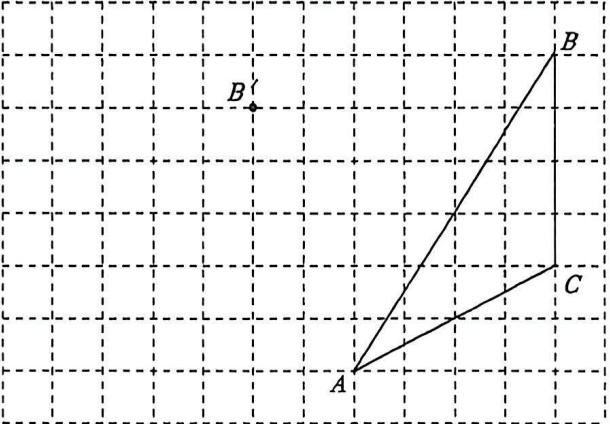

如图，在方格纸内将三角形 $ABC$ 经过一次平移后得到三角形 $A'B'C'$，图中标出了点 $B$ 的对应点 $B'$。利用网格点和直尺，完成下列各题：

（1）补全三角形 $A'B'C'$

（2）连接 $AA'$，$BB'$，则这两条线段之间的关系是 ___ ；

（3）在 $BB'$ 上画出一点 Q，使得三角形 BCQ 与三角形 ABC 的面积相等：

（4）如果 $B(-1,5)$，$C(-1,1)$ 请建立合适的平面直角坐标系并写出 $A'$ 点的坐标是 ___ ：

（5）若 B 向左移动了 $a(a > 0)$ 个单位，向下移动了 $b(b > 0)$ 个单位后得到了 $B'$，则 $a + b$ 的平方根是 ___ 。

> [!question]- 点击查看答案与解析
> **【答案】** （2）平行且相等；（4）$(1,3)$；（5）$\pm2$
> **【考点】** 平移的性质 → [[【初中数学知识点体系-人教版】#7-4 平移]]、坐标与图形 → [[【初中数学知识点体系-人教版】#9-2 坐标方法的简单应用]]
> **【解析】** （2）根据平移的性质，对应点的连线平行且相等，所以 $AA'$ 与 $BB'$ 平行且相等。（4）由 $B(-1,5)$，$C(-1,1)$ 可知 B、C 在同一条竖直线上，$BC=5-1=4$。根据网格建立平面直角坐标系，由图可知平移向量为向右 2 个单位、向下 2 个单位。所以 $A'$ 的坐标为 $(1,3)$。（5）由图可知，从 B 到 $B'$ 的水平距离为 2 个单位，竖直距离为 2 个单位。B 向左移动了 $a(a>0)$ 个单位，向下移动了 $b(b>0)$ 个单位后得到 $B'$，所以 $a=2$，$b=2$，$a+b=4$。$a+b$ 的平方根为 $\pm\sqrt{4}=\pm2$。
> **【易错点】** 不能正确从图中确定平移方向和距离；混淆平移方向与坐标变化的关系；求平方根时漏掉负值。
