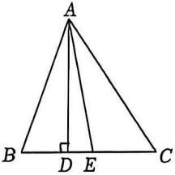

如图，在 $\triangle ABC$ 中，$AD$ 是 $BC$ 边上的高，$AE$ 平分 $\angle BAC$，$\angle C=40^\circ$，$\angle DAE=13^\circ$，求 $\angle B$ 的度数。

> [!question]- 点击查看答案与解析
> **【答案】** $\angle B=66^\circ$
> **【考点】** 三角形内角和 → [[【初中数学知识点体系-人教版】#13-3 三角形的内角与外角]]、角平分线 → [[【初中数学知识点体系-人教版】#7-1 相交线]]、高的性质 → [[【初中数学知识点体系-人教版】#7-1 相交线]]
> **【解析】** 因为 AD 是 BC 边上的高，所以 $\angle ADB=\angle ADC=90^\circ$。在 $\triangle ADC$ 中，$\angle C=40^\circ$，$\angle ADC=90^\circ$，所以 $\angle DAC=180^\circ-90^\circ-40^\circ=50^\circ$。因为 $\angle DAE=13^\circ$，所以 $\angle EAC=\angle DAC-\angle DAE=50^\circ-13^\circ=37^\circ$。因为 AE 平分 $\angle BAC$，所以 $\angle BAC=2\times\angle EAC=2\times37^\circ=74^\circ$。在 $\triangle ABC$ 中，$\angle BAC=74^\circ$，$\angle C=40^\circ$，所以 $\angle B=180^\circ-74^\circ-40^\circ=66^\circ$。
> **【易错点】** 不能正确利用高的性质求出 $\angle DAC$；在确定 $\angle EAC$ 时混淆角的加减关系。
