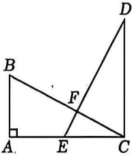

如图，点 $A$、$E$、$C$ 在同一直线上，$BA \perp AC$，$CD \parallel AB$，$BC = DE$，且 $\angle ACB = \angle D$。求证：$ED \perp BC$。

> [!question]- 点击查看答案与解析
> **【答案】** 证明见解析
> **【考点】** 全等三角形的判定与性质 → [[【初中数学知识点体系-人教版】#14-1 全等三角形及其性质]]、平行线的性质 → [[【初中数学知识点体系-人教版】#7-2 平行线]]
> **【解析】** 因为 $BA\perp AC$，所以 $\angle BAC=90^\circ$。因为 $CD\parallel AB$，所以 $\angle ACD=\angle BAC=90^\circ$（两直线平行，同位角相等）。在 $\triangle ABC$ 和 $\triangle CDE$ 中：$\angle ACB=\angle D$（已知），$BC=DE$（已知），$\angle BAC=\angle DCE=90^\circ$（已证），所以 $\triangle ABC\cong\triangle CDE$（ASA）。所以 $\angle B=\angle E$。因为 $\angle BAC=90^\circ$，所以 $\angle B+\angle ACB=90^\circ$。因为 $\angle E=\angle B$，所以 $\angle E+\angle ACB=90^\circ$。在 $\triangle BCE$ 中，$\angle BCE=180^\circ-\angle E-\angle ACB=180^\circ-90^\circ=90^\circ$。所以 $ED\perp BC$。
> **【易错点】** 不能正确找出全等三角形的对应角和对应边；混淆平行线的性质定理。
