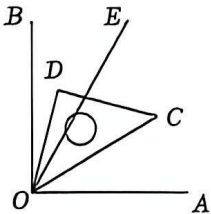
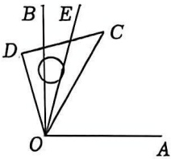
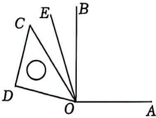

如图，已知 $\angle AOB = 90^{\circ}$"，三角形 $COD$ 是含有 $45^{\circ}$ 角的三角板，$\angle COD = 45^{\circ}$，OE 平分 $\angle BOC$

（1）如图1，当 $\angle AOC=30^\circ$ 时，$\angle DOE=$ ___ $^\circ$；

（2）如图2，当 $\angle AOC=60^\circ$ 时，$\angle DOE=$ ___ $^\circ$；

（3）如图3，当 $\angle AOC = \alpha (90^\circ < \alpha < 180^\circ)$ 时，求 $\angle DOE$ 的度数（用 $\alpha$ 表示）；

（4）由前三步的计算，当 $0^\circ < \angle AOC < 180^\circ$ 时，请直接写出 $\angle AOC$ 与 $\angle DOE$ 的数量关系为 ___ 。

图1 

图2 

图3 

> [!question]- 点击查看答案与解析
> **【答案】** （1）$75^\circ$；（2）$60^\circ$；（3）$\angle DOE=\frac{\alpha}{2}$；（4）当 $0^\circ<\angle AOC<90^\circ$ 时，$\angle DOE=90^\circ-\frac{1}{2}\angle AOC$；当 $90^\circ<\angle AOC<180^\circ$ 时，$\angle DOE=\frac{1}{2}\angle AOC$
> **【考点】** 角的计算 → [[【初中数学知识点体系-人教版】#6-3 角]]、角平分线 → [[【初中数学知识点体系-人教版】#7-1 相交线]]
> **【解析】** 由题意，$\angle AOB=90^\circ$，$\angle COD=45^\circ$，OE 平分 $\angle BOC$。（1）当 $\angle AOC=30^\circ$ 时，C 在 $\angle AOB$ 内部：$\angle BOC=\angle AOB-\angle AOC=90^\circ-30^\circ=60^\circ$，OE 平分 $\angle BOC$，所以 $\angle COE=\frac{1}{2}\angle BOC=30^\circ$，$\angle DOE=\angle DOC+\angle COE=45^\circ+30^\circ=75^\circ$。（2）当 $\angle AOC=60^\circ$ 时，C 在 $\angle AOB$ 内部：$\angle BOC=\angle AOB-\angle AOC=90^\circ-60^\circ=30^\circ$，OE 平分 $\angle BOC$，所以 $\angle COE=\frac{1}{2}\angle BOC=15^\circ$，$\angle DOE=\angle DOC+\angle COE=45^\circ+15^\circ=60^\circ$。（3）当 $\angle AOC=\alpha$（$90^\circ<\alpha<180^\circ$）时，C 在 $\angle AOB$ 外部：$\angle BOC=\angle AOC-\angle AOB=\alpha-90^\circ$，OE 平分 $\angle BOC$，所以 $\angle COE=\frac{1}{2}(\alpha-90^\circ)$，$\angle DOE=\angle DOC+\angle COE=45^\circ+\frac{1}{2}(\alpha-90^\circ)=45^\circ+\frac{\alpha}{2}-45^\circ=\frac{\alpha}{2}$。（4）综合前三问：当 $0^\circ<\angle AOC<90^\circ$ 时，$\angle DOE=90^\circ-\frac{1}{2}\angle AOC$；当 $90^\circ<\angle AOC<180^\circ$ 时，$\angle DOE=\frac{1}{2}\angle AOC$。
> **【易错点】** 不能正确根据 $\angle AOC$ 的大小确定 C 的位置（在 $\angle AOB$ 内部还是外部）；角平分线的计算出错。
