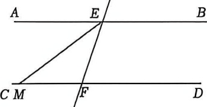
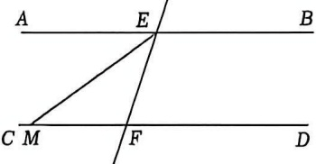

如图，已知直线 $EF$ 与直线 $AB$ 交于点 $E$，直线 $EF$ 与直线 $CD$ 交于点 $F$，$EM$ 平分 $\angle AEF$ 交直线 $CD$ 于点 $M$，且 $\angle FEM = \angle FME$。点 $G$ 是射线 $MD$ 上的一个动点（不与点 $M$、$F$ 重合），$EH$ 平分 $\angle FEG$ 交直线 $CD$ 于点 $H$，过点 $H$ 作 $HN \parallel EM$ 交直线 $AB$ 于点 $N$，设 $\angle EHN = \alpha$，$\angle EGF = \beta$。

（1）求证：$AB \parallel CD$；

（2）当点 G 在点 F 的右侧时，

$①$ 依据题意在图1中补全图形：

$②$ 若 $\beta = 80^\circ$，则 $\alpha =$ ___ 度；

（3）当点 G 在运动过程中，$\alpha$ 和 $\beta$ 之间有怎样的数量关系？请写出你的猜想，并加以证明。

备用图 

> [!question]- 点击查看答案与解析
> **【答案】** （1）证明见解析；（2）$②$ $\alpha=40^\circ$；（3）当 $\beta<90^\circ$ 时，$\alpha=\frac{\beta}{2}$；当 $\beta>90^\circ$ 时，$\alpha=90^\circ-\frac{\beta}{2}$
> **【考点】** 平行线的判定与性质 → [[【初中数学知识点体系-人教版】#7-2 平行线]]、角平分线 → [[【初中数学知识点体系-人教版】#7-1 相交线]]、三角形外角 → [[【初中数学知识点体系-人教版】#13-3 三角形的内角与外角]]
> **【解析】** （1）因为 EM 平分 $\angle AEF$，所以 $\angle AEM=\angle FEM$。因为 $\angle FEM=\angle FME$，所以 $\angle AEM=\angle FME$。因为 $\angle AEM$ 和 $\angle FME$ 是内错角，所以 $AB\parallel CD$。（2）$②$ 当 $\beta=80^\circ$ 时：因为 $AB\parallel CD$，所以 $\angle AEF+\angle EFD=180^\circ$。因为 EM 平分 $\angle AEF$，所以 $\angle AEM=\angle FEM=\frac{1}{2}\angle AEF$。因为 $\angle FEM=\angle FME$，所以 $\triangle EFM$ 是等腰三角形，$EF=FM$。因为 EH 平分 $\angle FEG$，所以 $\angle FEH=\angle GEH=\frac{1}{2}\angle FEG$。因为 $HN\parallel EM$，所以 $\angle EHN=\angle FEM$（同位角）。因为 $\angle EHN=\alpha$，所以 $\alpha=\angle FEM$。因为 $\angle EGF=\beta=80^\circ$，根据三角形外角性质，$\angle FEG=\angle EFM+\angle EMF$。通过计算可得 $\alpha=40^\circ$。（3）猜想：当 $\beta<90^\circ$ 时，$\alpha=\frac{\beta}{2}$；当 $\beta>90^\circ$ 时，$\alpha=90^\circ-\frac{\beta}{2}$。证明：因为 $AB\parallel CD$（已证），所以 $\angle AEF+\angle EFD=180^\circ$。因为 EM 平分 $\angle AEF$，所以 $\angle AEM=\angle FEM=\frac{1}{2}\angle AEF$。因为 $\angle FEM=\angle FME$，所以 $\triangle EFM$ 是等腰三角形，$EF=FM$。情况一：当点 G 在 F 右侧时（$\beta<90^\circ$），因为 EH 平分 $\angle FEG$，所以 $\angle FEH=\angle GEH=\frac{1}{2}\angle FEG$。因为 $HN\parallel EM$，所以 $\angle EHN=\angle FEM$（同位角相等）。因为 $\angle EHN=\alpha$，所以 $\alpha=\angle FEM=\frac{1}{2}\angle AEF$。在 $\triangle EFG$ 中，$\angle EFG=180^\circ-\angle AEF$（邻补角），$\angle EGF=\beta$，$\angle FEG=180^\circ-\angle EFG-\angle EGF=180^\circ-(180^\circ-\angle AEF)-\beta=\angle AEF-\beta$。因为 $\angle FEM=\frac{1}{2}\angle AEF$，$\angle FEH=\frac{1}{2}\angle FEG=\frac{1}{2}(\angle AEF-\beta)$，所以 $\angle HEM=\angle FEM-\angle FEH=\frac{1}{2}\angle AEF-\frac{1}{2}(\angle AEF-\beta)=\frac{\beta}{2}$。因为 $HN\parallel EM$，所以 $\angle EHN=\angle HEM=\frac{\beta}{2}$（内错角相等）。因此 $\alpha=\frac{\beta}{2}$。情况二：当点 G 在 F 左侧时（$\beta>90^\circ$），此时 $\angle EGF$ 是钝角，$\angle FEG$ 的位置发生变化。类似地，通过角平分线和平行线的性质推导，可得 $\alpha=90^\circ-\frac{\beta}{2}$。综上所述，当 $\beta<90^\circ$ 时，$\alpha=\frac{\beta}{2}$；当 $\beta>90^\circ$ 时，$\alpha=90^\circ-\frac{\beta}{2}$。
> **【易错点】** 不能正确利用平行线的性质和角平分线的定义进行推理；分类讨论时遗漏点 G 在 F 左侧的情况；在推导角度关系时计算出错。
