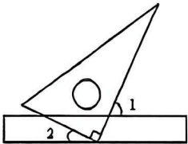

如图，将三角形的直角顶点放在直尺的一边上，若 $\angle 1=65^\circ$，则 $\angle 2$ 的度数为 ( )

A. $10^\circ$

B. $15^\circ$

C. $20^\circ$

D. $25^\circ$

> [!question]- 点击查看答案与解析
> **【答案】** D
> **【考点】** 平行线的性质、直角三角形两锐角互余 → [[【初中数学知识点体系-人教版】#7-2 平行线]]、[[【初中数学知识点体系-人教版】#13-3 三角形的内角与外角]]
> **【解析】** 如图，直尺的上下两边互相平行。三角形的直角顶点放在直尺的一边上，$\angle 1=65^\circ$。由题意，直角三角形的直角为 $90^\circ$，$\angle 1$ 与直角和 $\angle 2$ 所对应的角在同一直尺边上构成平角关系。由于直尺两边平行，$\angle 1$ 的内错角等于 $\angle 1=65^\circ$。在直角三角形中，$\angle 2$ 与 $\angle 1$ 的内错角和直角构成三角形内角和关系：$\angle 2=90^\circ-65^\circ=25^\circ$。
> **【易错点】** 不能正确利用平行线的性质找到角的等量关系，忽视直角三角形两锐角互余。
