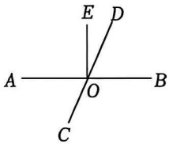

如图，直线 $AB$ 与直线 $CD$ 相交于点 $O$，$EO \perp AB$，$\angle EOD = 25^\circ$，则 $\angle AOC =$ ( )

A. $55^\circ$

B. $65^\circ$

C. $115^\circ$

D. $125^\circ$

> [!question]- 点击查看答案与解析
> **【答案】** B
> **【考点】** 垂直的定义、对顶角相等、邻补角 → [[【初中数学知识点体系-人教版】#7-1 相交线]]
> **【解析】** 已知 $EO\perp AB$，所以 $\angle EOB=90^\circ$。又 $\angle EOD=25^\circ$，所以 $\angle BOD=\angle EOB-\angle EOD=90^\circ-25^\circ=65^\circ$。因为 $\angle AOC$ 与 $\angle BOD$ 是对顶角，所以 $\angle AOC=\angle BOD=65^\circ$。
> **【易错点】** 不能正确利用垂直关系求出 $\angle BOD$，或混淆对顶角与邻补角的关系。
